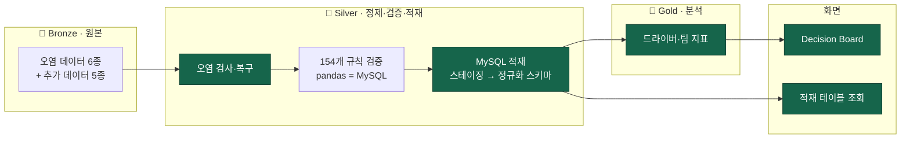
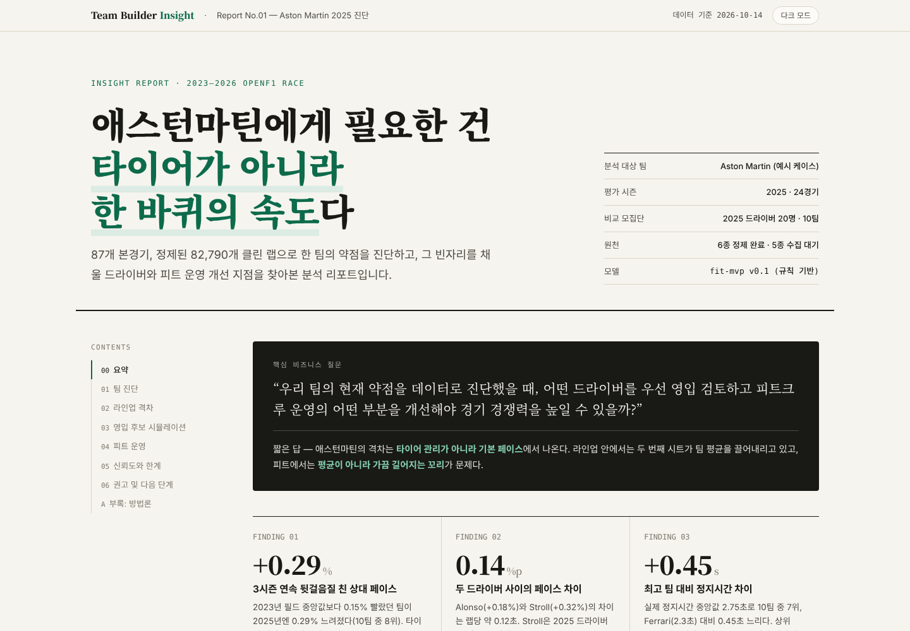
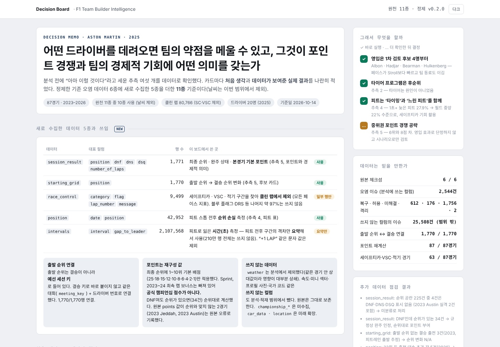
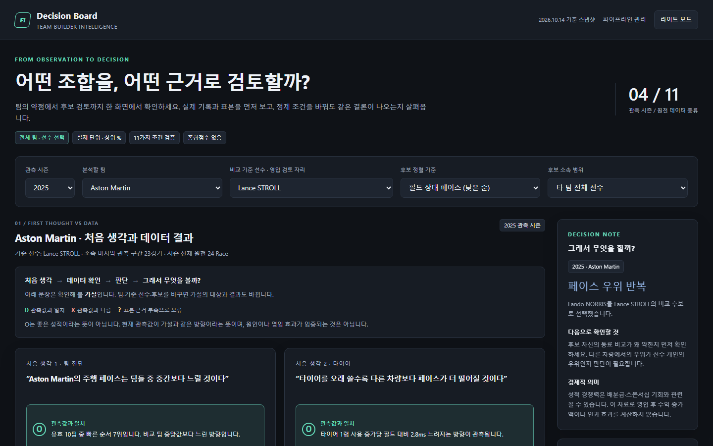

<h1 align="center">F1 Team Builder Intelligence · 2차 팀 프로젝트</h1>

<p align="center">
  오염된 F1 데이터를 <b>메달리온 구조(Bronze → Silver → Gold)</b>로 정제·적재·분석해<br/>
  "어떤 드라이버가 우리 팀의 약점을 메울 수 있는가"에 답하는 데이터 파이프라인과 Decision Board
</p>

<p align="center">
  <a href="https://github.com/encore-ai-campus/mlo-02-p2-team1">원본 팀 저장소</a> ·
  <a href="docs/MY_WORK.md">내 작업 상세 기록</a> ·
  <a href="docs/TEAM_README.md">팀 전체 README (분석 결과)</a>
</p>

---

## 한눈에 보기

| 항목 | 내용 |
|---|---|
| **주제** | 2025 Aston Martin의 약점(페이스·피트)을 데이터로 진단하고, 그 자리를 메울 드라이버 후보를 근거와 함께 선정 |
| **진행 방식** | 팀끼리 데이터를 교환해 진행: 우리 팀이 F1 데이터를 넘기면 상대 팀이 데이터를 **일부러 오염**시켜 돌려주고, 우리 팀이 그 오염 데이터를 정제해 분석 |
| **데이터** | 오염 데이터 6종(경기·선수·랩·스틴트·날씨·피트) + 분석 중 추가한 5종, 2023~2026 본경기 87경기 |
| **내 역할** | **오염 데이터 1차 복구**, **분석 화면 디자인 시안**, **MySQL 적재 오류 해결**, **Django 웹앱 구축과 Gold 계산·Decision Board** |
| **기술 스택** | Python, pandas, MySQL 8.4, SQL, Django 5.2, SQLAlchemy, HTML/CSS/JavaScript |
| **개발 방식** | 문제 정의·설계·검수는 직접 진행하고, 코드 구현에는 AI 코딩 도구를 함께 활용 |
| **결론** | 2025 Aston Martin의 STROLL 자리에는 **Charles LECLERC를 우선 검토** (근거: [팀 README](docs/TEAM_README.md)) |

---

## 작업 요약

| # | 작업 | 메달리온 단계 | 결과물 |
|:-:|---|:-:|---|
| 1 | **오염 데이터 1차 복구 파이프라인** | Bronze → Silver | 원본을 보존하면서 복구 근거를 행마다 남기는 첫 복구본과 리포트 |
| 2 | **분석 화면 디자인 시안 2종** | Gold → 화면 | Team Builder Insight Report, Decision Board(C안) |
| 3 | **MySQL 적재 오류 해결** | Silver | 1,335행 중 3행만 들어가던 적재 문제와 MySQL 8.4 검증 쿼리 오류 수정 |
| 4 | **Django 웹앱 구축** | 화면 | 적재 테이블 조회(`/data/`)와 Decision Board 화면 |
| 5 | **Gold 지표 계산** | Gold | MySQL 정규화 스키마에서 드라이버·팀 지표를 계산하는 `build_gold` 명령 |

---

## 메달리온 파이프라인과 내 작업 위치



<p align="center"><sub>초록색 칸이 제가 작업한 단계입니다. 복구(S1)는 1차 버전을 만들었고, 이후 팀원이 진단코드 27종 체계로 고도화했습니다.</sub></p>

---

## 1. 오염 데이터 1차 복구 파이프라인

> 관련 파일: 첫 버전 `run_pipeline.py`는 [원본 팀 저장소 기록](https://github.com/encore-ai-campus/mlo-02-p2-team1/commit/6bfa454)에 있고, 이후 팀원이 [`pipeline/recovery.py`](pipeline/recovery.py)로 재구성

**무엇을 했나**
- 상대 팀이 오염시켜 보낸 **6개 CSV(sessions, drivers, laps, stints, weather, pit)**를 원본 명세서와 파일 간 관계 규칙에 맞춰 점검하고 복구하는 첫 파이프라인을 만들었습니다.
- 예를 들어 drivers의 경기 장소 정보가 비어 있으면, **같은 `session_key`를 가진 sessions 행에서 값을 찾아** 채웠습니다. 근거가 있는 값만 복구했습니다.
- **원본값은 `original_*` 컬럼에 그대로 보존**하고, 복구한 칸마다 `repair_status`(복구 여부), `repair_method`(방법), `repair_confidence`(신뢰도), `repair_reason`(이유)를 남겼습니다.
- 결과물: 복구된 CSV 6종, 컬럼별 복구 요약, 행 단위 복구 근거(`repair_detail.csv`), HTML 품질 리포트

**이후 팀에서 이어진 것**
- 이 구조를 바탕으로 팀원이 진단코드 27종(`DQ001~DQ027`)과 154개 검증 규칙으로 고도화했습니다.
- "원본은 보존하고, **고친 이유와 고치지 않은 이유를 남긴다**"는 원칙은 최종 파이프라인까지 그대로 이어졌습니다.

---

## 2. 분석 화면 디자인 시안

> 관련 파일: [`design/index.html`](design/index.html), [`design/variants/C_decision_board.html`](design/variants/C_decision_board.html) (데이터가 파일 안에 들어 있어 브라우저로 바로 열람 가능)

### ① Team Builder Insight Report

분석 결과를 **한 편의 리포트처럼 읽히게** 구성한 시안입니다. 핵심 질문 → 짧은 답 → 근거 수치 3개 → 장별 상세 순서로 배치했습니다.

<p align="center"></p>

### ② Decision Board (C안)

기획안을 기준으로, 분석 전에 세운 **"처음 생각(가설)"과 "데이터가 보여준 실제 결과"를 카드마다 나란히** 놓는 구성을 만들었습니다.
- 100점짜리 종합점수 대신 **실제 기록 + 상위 %**로 후보를 비교
- 추가 데이터 5종을 어디에 썼는지, 데이터를 믿을 만한지(체크섬·복구·격리 건수)를 화면 안에 함께 표시

<p align="center"></p>

**이후 최종 화면으로**
"처음 생각 vs 데이터" 구성은 팀원이 완성한 최종 Decision Board(`/`)의 핵심 구조로 이어졌습니다. C안은 Gold 데이터와 연결된 상태로 `/gold/` 주소에 그대로 남아 있습니다.

<p align="center"><br/><sub>최종 Decision Board (팀원 완성)</sub></p>

---

## 3. MySQL 적재 오류 해결

> 관련 파일: [`sql/02b_reload_repair_detail.sql`](sql/02b_reload_repair_detail.sql), [`sql/03_validate_cleaned.mysql84.sql`](sql/03_validate_cleaned.mysql84.sql)

### 문제 1. 복구 이력 1,335행 중 3행만 적재됨

| 단계 | 내용 |
|---|---|
| **현상** | 복구 근거 파일 `repair_detail.csv`(1,335행)를 MySQL 스테이징 테이블에 넣었는데 **3행만** 들어갔습니다. 오류 메시지는 없었습니다. |
| **원인** | CSV가 **윈도우 줄바꿈(CRLF, `\r\n`)**으로 저장돼 있었고, 마지막 칸(`reason`)이 따옴표로 감싸져 있었습니다. 그런데 적재 SQL은 줄 끝을 `\n`으로만 읽고 있었습니다. 그래서 줄 구분이 어긋나 여러 행이 한 칸으로 붙어 버렸습니다. |
| **해결** | `LINES TERMINATED BY '\r\n'`으로 줄 끝 기준을 바로잡고, 따옴표 처리 옵션을 맞춘 재적재 SQL을 작성했습니다. 적재 후 `COUNT(*)`와 `reason` 최대 길이를 같이 출력해 **행 수와 내용이 온전한지 바로 확인**하게 했습니다. |
| **이후** | 기본 적재 SQL(02)도 `\r\n` 기준으로 정리돼 지금은 02만 실행해도 전체가 적재됩니다. 02b는 예전 방식으로 적재한 DB를 고칠 때만 쓰는 보정용으로 남겼습니다. |

### 문제 2. MySQL 8.4에서 검증 쿼리 실행 실패

| 오류 | 원인 | 해결 |
|---|---|---|
| `ERROR 1137` | MySQL은 **임시 테이블(TEMPORARY TABLE)을 한 쿼리 안에서 두 번 참조할 수 없음** | 작업용 테이블 `t_*`를 일반 테이블로 바꿈 |
| `ERROR 1292` | `position`이 빈 값인 행을 숫자로 `CAST`할 때 **STRICT 모드에서 오류** | `CASE`로 빈 값을 먼저 걸러낸 뒤 변환 |

원본 검증 SQL(`03_validate_cleaned.sql`)은 그대로 두고, MySQL 8.4 호환 수정본을 따로 만들었습니다.

---

## 4. Django 웹앱 구축

> 관련 파일: [`web/`](web/) — [`web/web/settings.py`](web/web/settings.py), [`web/viewer/`](web/viewer/), [`web/dashboard/`](web/dashboard/), [`run_web.bat`](run_web.bat)

- **Django 5.2 프로젝트**를 만들고 MySQL과 연결했습니다. DB 접속 정보는 코드에 넣지 않고 `.env`에서 읽도록 했습니다.
- **`viewer` 앱 (`/data/`)**: MySQL에 적재된 테이블 목록을 보여주고, 클릭하면 내용을 50행씩 조회하는 화면입니다. 적재가 제대로 됐는지 **SQL 없이 눈으로 확인**할 수 있게 했습니다.
- **`dashboard` 앱 (`/` → 현재 `/gold/`)**: Gold 데이터를 읽어 Decision Board를 보여주는 화면입니다. **화면은 계산하지 않고 Gold 결과를 읽기만** 하도록 역할을 나눴습니다.
- **`run_web.bat`**: 더블클릭 한 번으로 서버를 띄우는 실행 파일을 만들었습니다. 같은 네트워크의 다른 PC에서 시연용으로 접속할 수 있는 `run_web_lan.bat`도 함께 만들었습니다.
- 이후 팀원이 이 웹앱에 파이프라인 관리자 화면(`/ops/`)과 최종 Decision Board(`/`)를 추가했습니다.

---

## 5. Gold 지표 계산

> 관련 파일: [`web/dashboard/gold.py`](web/dashboard/gold.py), [`web/dashboard/models.py`](web/dashboard/models.py), [`web/dashboard/management/commands/build_gold.py`](web/dashboard/management/commands/build_gold.py)

- MySQL 정규화 스키마(Silver)에서 데이터를 읽어 Decision Board용 **Gold 지표를 계산**하는 `python web/manage.py build_gold` 명령을 만들었습니다.
- Gold 테이블 3개
  - `gold_driver_profile`: 시즌 × 드라이버별 페이스, 팀 동료 대비, 일관성, 타이어 유지, 포인트와 각 지표의 상위 %
  - `gold_team_profile`: 시즌 × 팀별 지표와 피트 기준값
  - `gold_snapshot`: 화면 한 장에 필요한 값을 **실행 시점·출처와 함께** 묶어 보관
- **클린 랩 규칙**: 공정한 비교를 위해 다음 랩은 지표 계산에서 뺐습니다.
  - 1랩, 피트 인·아웃 랩, 격리된 행
  - 세이프티카(SC)·VSC·적기 구간 (`race_control` 메시지로 구간 계산)
  - 드라이버 경기 중앙값의 107%를 넘는 랩
  - 경기당 15랩 미만
- 이렇게 **Silver(정제) → Gold(분석용 요약) → 화면(읽기 전용)**으로 단계를 나눠, 데이터가 바뀌면 `build_gold`만 다시 실행하면 화면이 갱신되게 했습니다.

---

## 트러블슈팅 한눈에 보기

| 문제 | 원인 | 해결 |
|---|---|---|
| 복구 이력 1,335행 중 3행만 적재 | CRLF 줄바꿈 + 따옴표 마지막 칸을 `\n` 기준으로 읽음 | `LINES TERMINATED BY '\r\n'`, 적재 후 행 수 확인 쿼리 |
| MySQL 8.4 `ERROR 1137` | 임시 테이블을 한 쿼리에서 두 번 참조 | 일반 작업 테이블로 변경 |
| MySQL 8.4 `ERROR 1292` | STRICT 모드에서 빈 값 `CAST` | `CASE`로 빈 값 처리 후 변환 |
| 디자인 시안이 좁은 화면에서 가로로 넘침 | 고정 폭 레이아웃 | 좁은 화면에 맞게 레이아웃 수정 |

---

## 회고

- **배운 점**
  - 데이터 정제에서 중요한 것은 많이 고치는 것이 아니라 **고친 근거와 고치지 않은 이유를 남기는 것**이라는 것
  - 오류 메시지 없이 조용히 틀리는 문제(3행만 적재)가 가장 위험하므로, 적재 후 **행 수를 반드시 대사**해야 한다는 것
  - 정제(Silver) → 분석(Gold) → 화면을 나누면, 각 단계를 따로 검증하고 다시 실행할 수 있어 협업과 수정이 쉬워진다는 것
- **어려웠던 점**
  - Gold 단계에서 "그래서 **왜** 이 드라이버인가?"에 답하고 설득하는 부분이 가장 어려웠습니다. 숫자를 보여주는 것과 그 숫자로 결정을 설득하는 것은 다른 일이었습니다.
- **다음에는**
  - Gold 계산에 쓴 분석 규칙을 처음부터 저장소 안의 코드로 관리해, 결과를 누구나 다시 만들 수 있게 하겠습니다.

작업별 상세 과정은 [docs/MY_WORK.md](docs/MY_WORK.md)에 정리했습니다.

---

## 팀원 작업

- 파이프라인 고도화: 진단코드 27종(`DQ001~DQ027`), pandas·MySQL 154개 검증 규칙, 정제 전후 비교
- 데이터 표준 사전, TO-BE 데이터 모델(MySQL 스키마) 설계
- 기획안과 최종 명세서([`F1_P2_Spec.md`](F1_P2_Spec.md))
- 드라이버 후보 선정 분석과 교체 시 우승확률 시뮬레이션
- 파이프라인 관리자 화면(`/ops/`), 최종 Decision Board(`/`), README와 발표자료

---

## 실행 방법

```bash
python -m venv venv
venv\Scripts\pip install -r requirements.txt
# .env 작성: DB_NAME, DB_USER, DB_PASSWORD, DB_HOST, DB_PORT
# sql/01 → 02 → 03(mysql84) → 04 → 05 → 06 순서로 MySQL에 실행
venv\Scripts\python.exe web\manage.py migrate
venv\Scripts\python.exe web\manage.py load_board_gold
venv\Scripts\python.exe web\manage.py build_gold
run_web.bat
```

| 주소 | 화면 |
|---|---|
| `http://127.0.0.1:8000/` | 최종 Decision Board |
| `http://127.0.0.1:8000/gold/` | Decision Board C안 (Gold 기반, 내 작업) |
| `http://127.0.0.1:8000/data/` | 적재 테이블 조회 (내 작업) |
| `http://127.0.0.1:8000/ops/` | 파이프라인 관리자 (관리자 계정 필요) |

자세한 설정은 [`web/README.md`](web/README.md)를 참고하세요.

## 주요 폴더

```text
data/        메달리온 단계별 데이터 (01_raw → 02_reference → 03_cleaned → 04_reports → 05_gold)
pipeline/    정제·검증 파이썬 모듈
sql/         MySQL 스테이징·검증·스키마·Gold 테이블 SQL
web/         Django 웹앱 (dashboard · viewer · ops)
design/      분석 화면 디자인 시안 (내 작업)
docs/        내 작업 기록, 팀 README, 상세 문서, 발표자료
tests/       파이프라인 테스트
```
